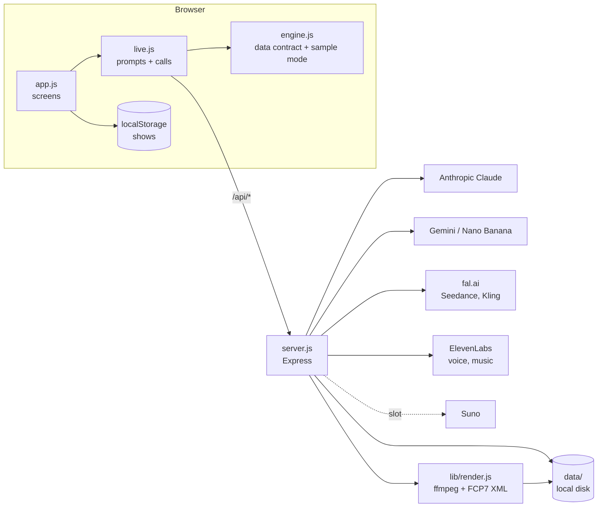

# ShowTime: Developer Handoff

Oct 19, 2026

## Overview

ShowTime is a working prototype that needs six services, a database, file storage and a job queue before it can take real users. The front end and the editing pipeline are built and tested; persistence, accounts and security are not.

ShowTime takes a one-sentence idea and walks a creator through eight parts (Story, Cast, Places, Look, Sound, Scenes, Trailer, Share), then publishes a **ShowPage** for the show, laid out like the Red District page. It merges the earlier ShowTime prototype with patterns from the Red District portal (hidden prompt layer, Object Storage, Resend, role keys).

**What works today**

- Front page, guided path, ShowPage with inline editing, collapsible sections, artwork gallery and image backgrounds.
- Series built as a season arc plus a three-act story per episode; scene lists per episode.
- Real writing through Claude (or Gemini), faces and places through Nano Banana, all optional by environment variable. With no keys the app runs in a labelled sample mode.
- Edit room: Claude cuts a trailer from scenes, uploads and music; in-browser preview; ffmpeg render to MP4; Premiere/Resolve export (FCP7 XML + media ZIP). Tested end to end on the server.
- Uploads of video, music, sound and images.

**Where the code is:** this repository (Node + Express, vanilla JS front end, no build step). The published Claude artifact is a single-file preview of the same front end and is not the production app.

## Third-party APIs and services

Four APIs are wired in now and Suno has a slot; email, a database, file storage and a job queue are needed before launch. Every wired API is optional: the server turns a feature on when its key is present.

| Service | What it powers | Status in code | Key / setting |
| --- | --- | --- | --- |
| [Anthropic Claude API](https://docs.claude.com) | All writing: ideas, first draft, season and episodes, cast, places, music and voice choices, scene lists, scene pages, pitch pack, ShowPage copy, trailer cuts | Wired (`/api/ai`) | `ANTHROPIC_API_KEY` |
| Google Gemini API (Nano Banana) | Faces (3:4) and place pictures (16:9); fallback writer if no Anthropic key | Wired (`/api/image`, `/api/ai`) | `GEMINI_API_KEY` |
| [fal.ai](https://fal.ai) | Video: Seedance 1.5 Pro text-to-video, Kling image-to-video. One key, many models, the way Higgsfield works | Wired (`/api/video`), not yet tested with a live key | `FAL_KEY` |
| ElevenLabs | Voice previews (text-to-speech); instrumental theme music (Eleven Music) | Wired (`/api/voice`, `/api/music`) | `ELEVENLABS_API_KEY` |
| Suno | Music, once partner access is granted. No public API as of July 2026 | Slot only; request shape is a guess | `SUNO_API_URL`, `SUNO_API_KEY` |
| Resend | Email: invites, magic-link login, notifications (already used in Red District) | Not wired in ShowTime | `RESEND_API_KEY` |
| Database (Postgres: Replit, Neon or Supabase) | Users, shows, versions, cuts, jobs. Shows live only in the browser today | **Needed** | `DATABASE_URL` |
| Object storage (Replit Object Storage or S3) | Pictures, clips, renders, exports. Today they go to local `data/`, which a redeploy wipes | **Needed** | bucket credentials |
| Job queue (Redis + BullMQ, or Postgres-backed) | Video generation, renders and exports. Today jobs live in memory and are lost on restart | **Needed** | `REDIS_URL` |
| Payments (Stripe) | Credits for generation, if the product charges | Open decision | `STRIPE_SECRET_KEY` |
| Error tracking (Sentry or similar) | Server and browser errors | Recommended | `SENTRY_DSN` |
| Optional render service (Shotstack or Creatomate) | Rendering at scale, taking the same timeline JSON | Optional; ffmpeg covers it today | service key |
| Optional lip-sync model (on fal) | Matching mouths to ElevenLabs dialogue | Not started | `FAL_KEY` |

## Software and code dependencies

The stack is deliberately small: Node with four npm packages on the server, and plain JavaScript in the browser with no build step.

| Piece | Version | Used for |
| --- | --- | --- |
| Node.js | 18 or later (tested on 22) | Server runtime; uses built-in `fetch` |
| `express` | 4.21.2 | HTTP server, static files, JSON and raw-upload bodies |
| `ffmpeg-static` | 5.2.0 | Bundled ffmpeg binary for rendering, thumbnails and probing; nothing to install on the host |
| `@fontsource/courier-prime` | 5.1.0 | Courier Prime font file for title cards in renders |
| `archiver` | 7.0.1 | Zips the Premiere/Resolve export |
| Front end | Vanilla JS, no framework, no build | `public/engine.js`, `live.js`, `app.js`, `styles.css` |
| Google Fonts | Courier Prime | The typewriter look in the browser |
| Playwright (dev only) | 1.56 | The end-to-end tests in `tests/` |

Red District's server adds `multer`, `sharp`, `@google/genai` and `@replit/object-storage`. Bring over `@replit/object-storage` (or the AWS S3 SDK) when storage moves off local disk.

## Environment variables

All are read in `server.js`. None is required to start; each one switches a feature on.

| Variable | Purpose | Default |
| --- | --- | --- |
| `PORT` | HTTP port | 3000 |
| `ANTHROPIC_API_KEY` | Writing with Claude | none |
| `WRITER_MODEL` | Model for normal writing | `claude-sonnet-5-5` (or `gemini-2.5-flash` without an Anthropic key) |
| `WRITER_MODEL_QUICK` | Model for small, fast calls (ideas, music, voices) | `claude-haiku-5-5` |
| `GEMINI_API_KEY` (or `GOOGLE_API_KEY`) | Faces and places; fallback writer | none |
| `IMAGE_MODEL` | Gemini image model | `gemini-2.5-flash-image` |
| `FAL_KEY` | Video generation | none |
| `VIDEO_MODEL_TEXT` | fal text-to-video model id | `fal-ai/bytedance/seedance/v1.5/pro/text-to-video` |
| `VIDEO_MODEL_IMAGE` | fal image-to-video model id | `fal-ai/kling-video/o3/standard/image-to-video` |
| `ELEVENLABS_API_KEY` | Voices and music | none |
| `ELEVEN_VOICES` | JSON mapping the app's voices `v1` to `v6` to ElevenLabs voice ids | six legacy premade voices |
| `SUNO_API_URL`, `SUNO_API_KEY` | Music through Suno, when available | none |

To add with the launch work: `DATABASE_URL`, `REDIS_URL`, storage bucket credentials, `RESEND_API_KEY` and `RESEND_FROM`, `SESSION_SECRET`, `SENTRY_DSN`, and `STRIPE_SECRET_KEY` if credits are sold.

## Architecture

One Express server serves the front end and relays calls to the AI services; there is no database, login or queue yet.

The prompt layer lives in the browser (`live.js`) and the server passes any prompt through. That keeps the prototype simple, but it is the first thing to change (see the notes below).

**Files**

| File | What it does |
| --- | --- |
| `server.js` | All routes; storage of uploads and generated media in `data/` |
| `lib/render.js` | ffmpeg render of a cut; FCP7 XML for Premiere and Resolve |
| `public/engine.js` | The original data contract (one show object), prompt-payload compiler, and sample-mode fallbacks |
| `public/live.js` | Real versions of every writing and media call, same names and return shapes as `engine.js` |
| `public/app.js` | Screens: front page, new show, the eight-step path, ShowPage, Edit room, popups |
| `public/styles.css` | Styles, light and dark |
| `tests/` | Browser tests used during the build |

**Endpoints**

| Route | Does | Notes |
| --- | --- | --- |
| `GET /api/ai/status` | Which services have keys | Drives sample mode in the UI |
| `POST /api/ai` | One prompt in, one JSON answer out | Accepts any prompt today |
| `POST /api/image` | Face (3:4) or place (16:9) picture | Saves to `data/images` |
| `POST /api/video`, `GET /api/video/:id` | Start and poll a fal job | Adds "No music, only sound effects and dialogue." to every prompt; copies the finished clip locally |
| `POST /api/voice` | ElevenLabs text-to-speech | Maps app voices to ElevenLabs ids |
| `POST /api/music` | Instrumental theme | Suno if configured, else ElevenLabs Music |
| `POST /api/upload` | Raw file upload, up to 500 MB | Returns url, duration, and a poster frame for video |
| `POST /api/render`, `GET /api/render/:id` | Render a cut to MP4 | About 5 s for a 22 s cut on the dev box |
| `POST /api/export` | Premiere/Resolve ZIP | XML plus every clip it uses |

**Data model.** One object per show, defined by `seedIP()` and `blankIP()` in `engine.js`: story (spine, acts, beats, short form), episodes, characters, worlds (places), visual, voices, music, scenes, trailer, bible, promo, plus the new fields `media`, `artwork`, `tracks`, `cuts`, `page`, `tagline`, `versions` and `rev`. Episode acts are stored under `story.acts["<episode>:<act>"]`; a series' season arc under `story.acts["season:<act>"]`. `compilePayload()` turns the show into the context every model call receives. This object is what the database should store, one row (or JSON document) per show plus a version history.

## Notes for the senior developer

Six things must change before real users touch it, in this order: lock down the API, move prompts to the server, add accounts and a database, move files to object storage, add a job queue, and add cost controls.

1. **Lock down the API.** No route checks who is calling. Anyone who finds the URL can spend the Anthropic, Gemini, fal and ElevenLabs budgets.
   - Require a session on every `/api` route except status and static files.
   - Add per-user rate limits and a per-user daily spend cap.
2. **Move the prompt layer to the server.** `live.js` builds the prompts in the browser and `/api/ai` accepts any prompt. Today it is an open relay to the model.
   - Replace `/api/ai` with task routes (`/api/draft`, `/api/episodes`, `/api/cut`, and so on) that take the show id and options, build the prompt server-side, and validate the JSON before saving.
   - The grounding rules (`HOUSE` in `live.js`), cast sizes and editing brief move with them. This also keeps the prompts private.
3. **Accounts and a database.** Shows live in each browser's localStorage, so nothing syncs and invites cannot work.
   - Store the show object as JSON per row (Postgres `jsonb`), with a versions table for history and `team` as a real membership table with roles.
   - Reuse Red District's magic-link login and role keys (admin, editor, viewer). Email goes through Resend.
4. **Object storage.** Uploads, pictures, clips, renders and exports are written to `data/`, which a redeploy wipes.
   - Move to Replit Object Storage (pattern in Red District's `lib/storage.js`) or S3, and serve through signed URLs.
   - `/api/upload` buffers up to 500 MB in memory (`express.raw`). Change it to stream to disk or straight to storage (busboy or presigned uploads).
5. **A job queue.** Video jobs, renders and exports are tracked in in-memory `Map`s, lost on restart, and renders run one at a time on the web process.
   - Use BullMQ on Redis (or a Postgres-backed queue) with a separate worker for ffmpeg.
   - Use fal webhooks instead of 5-second polling.
6. **Cost controls.** One "Make my ShowPage" on a series can now make 12 to 18 faces, 6 to 10 place pictures and several long writing calls.
   - Decide on credits and show the cost before any batch job.
   - Video is the expensive part: keep it on explicit request only, as it is now.

**Security details to fix along the way**

- `lib/render.js` `localize()` fetches any `http(s)` URL in a timeline: server-side request forgery. Only allow files from our own storage once timelines are built server-side.
- `/api/image` and video prompts include user text; keep the server-side "original person, adult, not a likeness of anyone real" wording, and add a moderation pass for the mature-content policy.
- Uploaded files are served from `/media` with their own extension. Check content type on upload, and never serve user HTML or SVG from the app's own domain.

## Verify, known gaps, next builds

The writing, rendering and export paths were tested with stand-in data; none of the paid APIs has been called with a live key yet, so the first job is a live smoke test of each.

**Verify with live keys**

- [ ] Claude: model ids `claude-sonnet-5-5` and `claude-haiku-5-5`; a full series draft fits in `max_tokens` 8000.
- [ ] Gemini image: `gemini-2.5-flash-image` with `imageConfig.aspectRatio` returns inline image data.
- [ ] fal: input field names for the Kling image-to-video model. The server sends `prompt`, `image_url`, `duration`, `aspect_ratio`, and fal's page for that model did not list them. Kling v2.1 text-to-video is deprecated on fal.
- [ ] fal: the image URL passed for image-to-video must be public; local `/images/...` paths will fail until storage gives public or signed URLs.
- [ ] ElevenLabs: the six default voice ids are legacy premade voices; replace them via `ELEVEN_VOICES`. Confirm `/v1/music` with `force_instrumental`.
- [ ] Suno: the request shape is a placeholder until partner access.

**Known gaps**

- Scene videos carry their own generated audio; ElevenLabs lines are not yet laid onto scene clips, and there is no lip-sync step.
- The Edit room cuts trailers only. Scenes and full episodes use the same engine but need their own flows. An episode is about 150 to 250 shots.
- No captions burned in or exported as SRT yet.
- Invites and "Build the show page" (public link) are mocks (`inviteCollaborator`, `publishShowPage` in `app.js`).
- Uploaded clips in the browser-only preview last until reload; fine for the artifact, not for production.
- `engine.js` still carries old mock functions used as sample-mode fallbacks; once the server owns prompts, sample mode can move to fixtures.
- The tests in `tests/` are plain scripts that print results; move them to `@playwright/test` with assertions and run them in CI.

**Recommended next builds**

1. Server-side prompts, accounts, database and storage (the notes above).
2. Scene assembly: generate shots per scene, lay ElevenLabs dialogue, optional lip-sync, cut with the Edit room engine.
3. Episode assembly from approved scenes, with captions.
4. Public ShowPage with timed trailer notes, as on Red District, and Red District imported as the first project.

## Open decisions

Five product calls change what gets built; each needs an owner before the launch work starts.

| Decision | Options | Why it matters to engineering |
| --- | --- | --- |
| Hosting | Replit Reserved VM, or AWS App Runner with S3 | Storage SDK, worker setup, request timeouts (avoid API Gateway's 29-second limit) |
| Pricing and credits | Free tier with caps; credits per generation; subscription | Metering, Stripe, cost shown before batch jobs |
| Video provider | fal (Kling, Seedance) now; Higgsfield's API or direct vendor APIs later | Adapter layer; model ids are already configurable |
| Music | ElevenLabs Music now; Suno when partner access arrives | Second adapter; licensing terms for user projects |
| Mature content line | What the platform allows, given Red District's subject matter | Moderation pass, prompt wording, reviewer tools |

## Sources

- [fal.ai: Seedance 1.5 Pro text-to-video API](https://fal.ai/models/fal-ai/bytedance/seedance/v1.5/pro/text-to-video/api)
- [fal.ai: Kling v2.1 text-to-video (marked deprecated)](https://fal.ai/models/fal-ai/kling-video/v2.1/master/text-to-video/api)
- [ElevenLabs Music API reference](https://elevenlabs.io/docs/api-reference/music/compose)
- [Digital Music News: Suno is opening an API partner program (July 2026)](https://www.digitalmusicnews.com/2026/07/03/suno-is-opening-an-api-partner-program/)
- [Higgsfield: generating videos with the Higgsfield API](https://higgsfield.ai/blog/generate-ai-videos-higgsfield-api)
